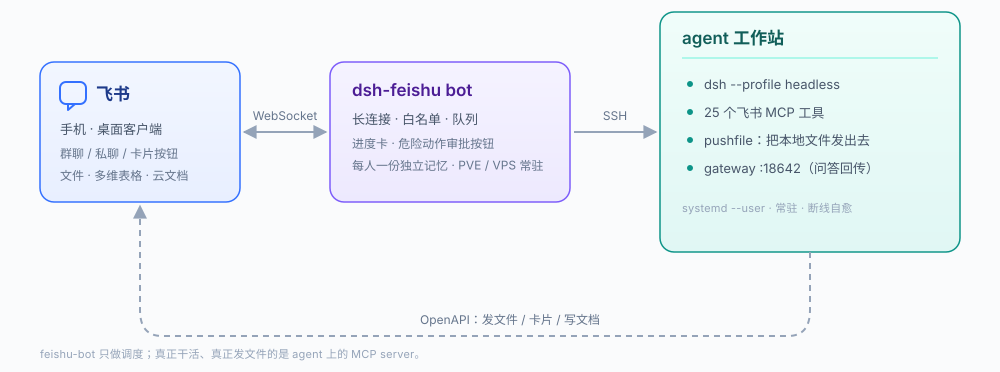

<p align="center">
  
</p>

<h1 align="center">dsh-feishu</h1>

<p align="center">
  让 agent 真正住进飞书。<br>
  <sub>MCP server · 长连接机器人 · 卡片网关 · DSH 设置页 &nbsp;·&nbsp; MIT</sub>
</p>

---

飞书里的对话就是 agent 的操作台。你在手机上发一句话，它在你的机器上干活，
把**文件**、**卡片**、**多维表格**直接发回群里 —— 而不是回你一堆「我建议你执行以下命令」。

不需要公网 IP，不需要内网穿透，不需要域名和证书。

## 它能干什么

| 你说 | 它做 |
| --- | --- |
| 把上周的纳米技术报告发我 | 在工作区找到 3 份 `.docx`，**真的传进群里** |
| 建一张读书清单的多维表格 | 建表 → 建 4 个字段 → 写入第一条记录，回你链接 |
| 跑一下这个季度的文献综述，做完汇报 | 排进队列，**进度写在同一张卡片上**，聊天里只留一个气泡 |
| 清一下 `/home/agent/work/old` | 先弹一张审批卡，你点「批准」才执行 |
| 我在高铁上，帮我看下服务器还活着吗 | 回你 CPU / 内存 / 磁盘 / 服务状态 |

配套的机器人还管这些：白名单认领、每人一份独立会话记忆、任务队列、超时兜底、每日汇报、危险动作拦截。

## 为什么不是 `@larksuiteoapi/lark-mcp`

官方 lark-mcp 做的是**广度**：把飞书 OpenAPI 按元数据摊给模型。它很好，但「把 IM 当 agent 界面」最要紧的四件事它没有：

| 缺口 | lark-mcp | 本项目 |
| --- | --- | --- |
| **发本地文件** | 没有 `im.v1.file.create` 这条链，本地文件传不进会话 | `feishu_send_file` / `feishu_send_image`：路径 → 上传 → 发消息 |
| **会话上下文** | 只有「列消息」的原始接口 | `feishu_recent`：拍平成 `[时间] 发送人：内容`，模型一眼能读 |
| **阻塞式提问** | 标准 MCP 是请求-响应，没有「等人回答」 | `feishu_ask`：发带按钮的卡片，阻塞等到你点，把答案带回来 |
| **卡片原地更新** | 只会发卡，不会改卡，进度只能刷屏 | `feishu_update_card`：聊天里只留一个气泡，反复刷新 |

如果你的需求是「用脚本批量调飞书 OpenAPI」，用 lark-mcp 更省事；
如果是「让 agent 像同事一样在飞书里干活」，缺的正是上面四块。

## 装上

**前置**：一个飞书自建应用（scope 见[权限](#权限)）、一台跑 DeepSeek Harness 的机器、Node 22+。

```bash
pnpm install && pnpm build

node scripts/install.mjs \
  --app-id cli_xxxxxxxx \
  --app-secret xxxxxxxx \
  --chat-id oc_xxxxxxxx
```

安装器会做四件事，每一步都可单独重跑：

1. **校验凭据** —— 真去换一次 `tenant_access_token` 并列会话，凭据错当场就报
2. **写密钥文件** —— `~/.config/dsh/feishu.env`，权限 `0600`
3. **装 MCP 启动包装** —— 一个 `dsh-feishu-mcp` 小脚本（stdio 子进程会被清空环境变量，密钥得由包装自己 source）
4. **改 profile** —— 幂等地往 `cordis.patch.yml` 写一段带哨兵的托管块

然后重启 DSH，让模型报一下工具：

```bash
echo '你有哪些 mcp__feishu__ 工具？只列名字' | dsh --profile headless --json -
```

`--uninstall` 只回滚第 3、4 步，不动你的密钥文件。可选 `--profile <名字>`（默认 `headless`）、`--dir <安装目录>`、`--skip-check`。

<details>
<summary>只想挂 MCP，不要机器人</summary>

手工编辑 `~/.dsh/profiles/<profile>/cordis.patch.yml`：

```yaml
- insert:
    - id: mcp-feishu
      name: '@deepseek-ai/dsh-mcp-client'
      config:
        transport: stdio
        serverName: feishu
        command: node
        args: ['/绝对路径/packages/mcp/dist/server.js']
        # feishu_ask 最多阻塞 600s，工具超时必须比它大
        toolCallTimeoutMs: 660000
        env:
          FEISHU_APP_ID: 'cli_xxx'
          FEISHU_APP_SECRET: 'xxx'
          FEISHU_DEFAULT_CHAT_ID: 'oc_xxx'
```

注意 `serverName: feishu` 决定工具前缀（`mcp__feishu__*`），改了前缀也就变了。
</details>

## 25 个工具

工具名在客户端里带前缀，形如 `mcp__feishu__feishu_send_text`。参数细节见 [docs/TOOL-CONTRACT.md](docs/TOOL-CONTRACT.md)。

| 分组 | 工具 |
| --- | --- |
| **身份 / 卡片** | `feishu_whoami` 查机器人身份与可达会话 · `feishu_send_info_card` 发「标签+值」信息卡 |
| **发消息** | `feishu_send_text` 纯文本 · `feishu_send_card` 任意卡片 JSON · `feishu_update_card` 原地刷新 · `feishu_reply` 引用回复 |
| **文件** | `feishu_send_file` 本地文件（30MB，可批量 + 说明文字）· `feishu_send_image` 图片（10MB）· `feishu_download` 把消息附件落到本地 |
| **上下文** | `feishu_recent` 读最近消息（时间正序、默认滤掉机器人自己）· `feishu_ask` 发问并等人回答 |
| **通讯录** | `feishu_chats` 列机器人所在会话 · `feishu_members` 列成员 |
| **多维表格** | `feishu_bitable_tables` · `feishu_bitable_fields`（带类型码与写入形态）· `feishu_bitable_records`（单元格渲染成人话）· `feishu_bitable_add` · `feishu_bitable_update` · `feishu_sheet_create` |
| **文档 / 云空间 / 知识库** | `feishu_drive_list` · `feishu_doc_read` · `feishu_doc_create` · `feishu_wiki_spaces` · `feishu_wiki_node` · `feishu_user_lookup` |

另有卡片模板（`progressCard` / `resultCard` / `askCard` / `chatListCard`）和统一的错误翻译：
scope 没开时 `FeishuApiError.missingScopes` 会把该开哪几项直接拼进错误文本，模型能照着提示你。

## 权限

飞书开放平台 →「权限管理」开这些 scope，改完**要发版本**才生效：

| scope | 用于 |
| --- | --- |
| `im:message:send_as_bot` | 所有发送类工具 |
| `im:resource` | 文件 / 图片的上传下载 |
| `im:chat` | 列会话、列成员 |
| `im:message.group_msg` | 读群聊历史（`feishu_recent` / `feishu_ask`） |
| `im:message.p2p_msg:readonly` | 读单聊历史 |
| `drive:drive` | 云空间 |
| `docx:document` · `docx:document:create` | 读写云文档 |
| `wiki:wiki:readonly` | 知识库 |
| `bitable:app` | 多维表格 |
| `contact:user.id:readonly` | 邮箱 / 手机 → open_id |

两件不在 scope 里的事：

- 机器人得**先被拉进群**，`feishu_chats` 只列它已经加入的会话。
- 卡片要能原地更新，发卡时就必须带 `config.update_multi = true` —— 本项目自带模板默认都带。

## 架构



三个角色，各管一段：

- **`feishu-bot`**（`services/feishu-bot`）— 跑在能长连接的地方。管认人、会话、队列、进度卡、审批按钮。它自己**不干活**。
- **agent** — 真正执行的地方。`dsh --profile headless` 调模型，25 个 MCP 工具就是它的手。
- **`gateway`**（`packages/gateway`）— 常驻小服务（默认 `:18642`），只干一件事：把卡片按钮的点击**精确投递给正在等回答的那次 `feishu_ask`**。以 `NO_WS=1` 运行，不碰长连接，避免和机器人抢事件。

```
packages/
├── core/          @dsh-feishu/core      API 客户端 · 类型 · 卡片模板（零第三方 HTTP 依赖）
├── mcp/           @dsh-feishu/mcp       25 个工具的 MCP server
├── gateway/       @dsh-feishu/gateway   卡片问答网关（HTTP + 可选长连接）
└── dsh-plugin/    @dsh-feishu/dsh-plugin DSH 设置页（在 Web UI 里填凭据、测连接）
services/
├── feishu-bot/    飞书长连接机器人 + 一键部署脚本
└── agent-workspace/  工作区清理器（按「能否一条命令重建」分级清理）
docs/             TOOL-CONTRACT · ARCHITECTURE · DEPLOY · GATEWAY · BOT-INTEGRATION · AGENT-WORKSPACE
```

**改代码前请记住两条硬约束**：

1. **stdout 只能出 MCP 的 JSON-RPC**。任何 `console.log` 都会破坏协议，日志一律走 stderr。
2. **工具 handler 整体 try/catch**，异常必须翻译成 `fail(...)` 返回，不许往上抛。

## 状态

版本 `0.1.0`，**实验阶段**：接口和工具名还会变，暂不保证向后兼容。

- 194 个单测（core 117 + gateway 77），CI 跑 typecheck + test + build
- 已知限制：`feishu_ask` 轮询有延迟与配额成本、单文件 30MB 上限、没有多实例锁
  —— 详见 [docs/ARCHITECTURE.md](docs/ARCHITECTURE.md)

## 文档

| 文档 | 讲什么 |
| --- | --- |
| [ARCHITECTURE.md](docs/ARCHITECTURE.md) | 分层、关键取舍、已知限制 |
| [TOOL-CONTRACT.md](docs/TOOL-CONTRACT.md) | 写工具前必读的实现契约 |
| [DEPLOY.md](docs/DEPLOY.md) | 部署到服务器 |
| [GATEWAY.md](docs/GATEWAY.md) | 网关协议与部署 |
| [BOT-INTEGRATION.md](docs/BOT-INTEGRATION.md) | 机器人与网关怎么对接 |
| [AGENT-WORKSPACE.md](docs/AGENT-WORKSPACE.md) | 工作区归档规则 |

## License

MIT
