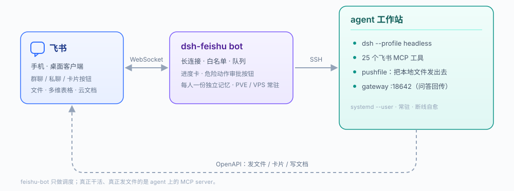

<p align="center">
  
</p>

<h1 align="center">dsh-feishu</h1>

<p align="center">
  让 agent 真正住进飞书。<br>
  <sub>MCP server · 长连接机器人 · 卡片网关 · DSH 设置页 &nbsp;·&nbsp; MIT</sub>
</p>

<p align="center">
  <a href="https://github.com/yinsang0910-star/dsh-feishu/actions/workflows/ci.yml"></a>
  <a href="https://github.com/yinsang0910-star/dsh-feishu/releases/latest"></a>
  
</p>

---

## 它是什么

飞书会话就是 agent 的操作台。在手机上发一句话，它在你的机器上执行，把**文件**、**卡片**、
**多维表格**发回会话——而不是回你一段「建议执行以下命令」。

不需要公网 IP、内网穿透、域名或证书：机器人主动向飞书发起 WebSocket 长连接，不开放入站端口。

它由三个角色组成，各自负责一段：

| 角色 | 职责 |
| --- | --- |
| `feishu-bot` | 常驻长连接。身份校验、会话管理、任务队列、进度卡、审批按钮。自身不执行任务 |
| agent | 实际执行方。`dsh --profile headless` 调用模型，36 个 MCP 工具是它的操作面 |
| `gateway` | 只做一件事：把卡片按钮的点击精确投递给正在等待回答的那次 `feishu_ask` |

## 它解决什么问题

| 你说 | 它做 |
| --- | --- |
| 把上周的纳米技术报告发我 | 在工作区找到 3 份 `.docx`，上传并发送到会话 |
| 建一张读书清单的多维表格 | 建表 → 建 4 个字段 → 写入第一条记录，返回链接 |
| 跑一下这个季度的文献综述，做完汇报 | 排进队列，进度在**同一张卡片**里刷新，聊天中只占一个气泡 |
| 清一下 `/home/agent/work/old` | 先发审批卡，确认后才执行 |
| 我在高铁上，帮我看下服务器还活着吗 | 返回 CPU / 内存 / 磁盘 / 服务状态 |
| 发一张试卷照片，说「帮我批改」 | 图片经 `read_image` 真正打开，逐题给出对错 |
| 换个最会想的模型，慢慢算 | `/模型` 点按钮换模型，`/思考` 切 `reasoningEffort`（含 `auto` 自动挡），切换前先真跑一次确认可用 |
| 群里三个人同时发话 | 并行执行（默认上限 3 路），同一个人的任务仍按顺序；回复 @ 到人，群静音也收得到 |
| 选中一张旧图说「你重新做这个」 | 先取回被引用的消息，图片重新下载落盘，模型再看一遍 |

机器人另外承担：白名单认领、每人一份独立会话记忆、任务队列、超时兜底、每日汇报、危险动作拦截。
图片与文件消息的处理见 [BOT-ATTACHMENTS.md](docs/BOT-ATTACHMENTS.md)，群内免 @ 见
[BOT-GROUP-MODE.md](docs/BOT-GROUP-MODE.md)，并发与引用回溯见 [BOT-RUNTIME.md](docs/BOT-RUNTIME.md)。

## 安装

**前置条件**：一个飞书自建应用、一台能运行 DeepSeek Harness 的机器、Node 22+。
应用需要开通的 scope 见[权限](#权限)。

### 方式一：设置页向导（推荐）

装好插件后，DSH 设置面板左栏会多出「**飞书连接**」，内含四步向导
（步骤条 `1 建应用 → 2 填凭据 → 3 选会话 → 4 自检`，完成一步点亮一项）：

1. **建应用** —— 直达开放平台的链接，附 11 项权限清单，可一键复制
2. **填凭据** —— App ID / Secret，保存时先校验再落盘，凭据错误不会写坏文件
3. **选会话** —— 「扫描我的会话」列出机器人所在会话，无需手抄 32 位 `oc_` 串
4. **自检** —— 九项逐个真调接口：凭据文件、MCP 挂载、应用凭据、机器人身份、会话列表、
   目标会话、读聊天记录、上传文件、云空间

自检每项下方一行小字是判定依据：凭据文件末四位、token 剩余秒数、机器人应用名、会话名、
`file_key` 前几位。九项全绿时底部提示「工具已经挂进 profile，重启 DSH 之后 `mcp__feishu__*` 就能用了」。
失败项会给出该开通的 scope 与跳转链接，并支持「一次开通全部缺失权限」。

自检不往会话里发任何内容：读历史只读 1 条，上传只传 20 字节且不发送。

### 方式二：命令行安装

```bash
pnpm install && pnpm build

node scripts/install.mjs \
  --app-id cli_xxxxxxxx \
  --app-secret xxxxxxxx \
  --chat-id oc_xxxxxxxx
```

安装器执行四步，每步可单独重跑：

1. **校验凭据** —— 实际换取一次 `tenant_access_token` 并列出会话，凭据错误立即报出
2. **写密钥文件** —— `~/.config/dsh/feishu.env`，权限 `0600`
3. **安装 MCP 启动包装** —— 生成 `dsh-feishu-mcp` 脚本（stdio 子进程的环境变量会被清空，
   密钥需由包装脚本自行 source）
4. **修改 profile** —— 幂等地向 `cordis.patch.yml` 写入带哨兵的托管块

重启 DSH 后，让模型报告工具清单：

```bash
echo '你有哪些 mcp__feishu__ 工具？只列名字' | dsh --profile headless --json -
```

`--uninstall` 只回滚第 3、4 步，不改动密钥文件。可选参数：`--profile <名字>`（默认 `headless`）、
`--dir <安装目录>`、`--skip-check`。

### 关于建应用的两点

**扫码建应用**：第 2 步的「扫码创建」走飞书官方
[RFC 8628 设备授权流程](https://accounts.feishu.cn/oauth/v1/app/registration)。
二维码内容是 `open.feishu.cn/page/launcher?user_code=...`，手机确认后应用自动创建，
App ID 与 Secret 直接写入本机 `feishu.env`——浏览器全程不接触 secret，也不需要手抄任何一串。

**权限仍需手动开通**：应用创建后按第 1 步的清单勾选（提供深链与一键复制）。
飞书没有允许第三方代开权限的通道，这一步无法省略。

### 只挂 MCP，不要机器人

MCP server 已打成**自包含单文件**（SDK 与 core 都打包在内），不需要 `pnpm install`，也不从 npm 安装。

**Claude Desktop**：从 [Releases](https://github.com/yinsang0910-star/dsh-feishu/releases/latest) 下载
`dsh-feishu-mcp-<版本>.mcpb`，双击安装，在配置面板填入 App ID 与 App Secret。
（同一产物也在镜像仓库 [dsh-feishu-mcp](https://github.com/yinsang0910-star/dsh-feishu-mcp) 的 Releases 中。）

**其他 stdio 客户端**：

```bash
npx github:yinsang0910-star/dsh-feishu-mcp
```

或从 [Releases](https://github.com/yinsang0910-star/dsh-feishu/releases/latest) 下载
`dsh-feishu-mcp-<版本>.mjs`，`node dsh-feishu-mcp.mjs` 即可运行（1.5 MB，含全部依赖）。

**Docker**（镜像里不含任何凭据，运行时注入）：

```bash
docker build -t dsh-feishu-mcp .
docker run --rm -i -e FEISHU_APP_ID=cli_xxx -e FEISHU_APP_SECRET=xxx dsh-feishu-mcp
```

未配置凭据时进程仍会启动并完成握手，`tools/list` 正常返回 36 个工具，只有真正调用工具才返回「飞书凭据未配置」——目录站与客户端的自检因此不会看到「server 崩了」。

提供 `FEISHU_APP_ID` / `FEISHU_APP_SECRET` 即可运行。挂进 DSH 的方式是编辑
`~/.dsh/profiles/<profile>/cordis.patch.yml`：

```yaml
- insert:
    - id: mcp-feishu
      name: '@deepseek-ai/dsh-mcp-client'
      config:
        transport: stdio
        serverName: feishu
        command: npx
        args: ['-y', 'github:yinsang0910-star/dsh-feishu-mcp']
        # feishu_ask 最多阻塞 600s，工具超时必须比它大
        toolCallTimeoutMs: 660000
        env:
          FEISHU_APP_ID: 'cli_xxx'
          FEISHU_APP_SECRET: 'xxx'
          FEISHU_DEFAULT_CHAT_ID: 'oc_xxx'
```

`serverName: feishu` 决定工具前缀（`mcp__feishu__*`），改动它前缀随之改变。
改代码时改为运行本仓库产物：`command: node` + `args: ['/绝对路径/packages/mcp/dist/server.js']`。

镜像仓库 [yinsang0910-star/dsh-feishu-mcp](https://github.com/yinsang0910-star/dsh-feishu-mcp)
由 `scripts/publish-mcp-repo.ps1` 单向同步，请勿在该仓库直接改代码。

## 装完之后

### 建议同时装记忆插件

本项目只保证**会话内**连续（同一人 + 同一工作目录）。跨会话、跨项目的长期记忆建议交给
[dsh-mnemon](https://github.com/omdsh-dev/dsh-mnemon)（作者 [@Grivn](https://github.com/Grivn)，MIT）。

不装的症状很具体：今天告诉它「我叫什么、别用术语」，明天开新会话它一样不知道。装了之后
这些写进 `~/.mnemon/runtime/`，每次进上下文。

需要注意：机器人在飞书里跑的是 **headless profile**，桌面端装过的记忆插件对它无效——
headless 默认只挂了 `base` + `headless` 两个 bundle。一条命令补齐：

```bash
bash services/agent-workspace/install-mnemon.sh      # 幂等，已装则只做检查
```

原理、验证方法、三个坑与回滚见 [MNEMON.md](docs/MNEMON.md)。

### 先看一眼指令

`/help` 返回一张可点击的卡片：切换模型、切换 `reasoningEffort`、查看状态、管理工作区、
开关群内是否需要 @。完整指令见 [BOT-COMMANDS.md](docs/BOT-COMMANDS.md)。

## 权限

在飞书开放平台「权限管理」开通以下 scope，修改后**需要发布版本**才生效：

| scope | 用于 |
| --- | --- |
| `im:message:send_as_bot` | 所有发送类工具 |
| `im:resource` | 文件 / 图片的上传下载 |
| `im:chat` | 列会话、列成员 |
| `im:message.group_msg` | 读群聊历史（`feishu_recent` / `feishu_ask`） |
| `im:message.p2p_msg:readonly` | 读单聊历史 |
| `drive:drive` | 云空间 |
| `docx:document` · `docx:document:create` | 读写云文档 |
| `wiki:wiki:readonly` | 知识库 |
| `bitable:app` | 多维表格 |
| `contact:user.id:readonly` | 邮箱 / 手机 → open_id |

两项不属于 scope 配置：

- 机器人必须**先被拉进群**，`feishu_chats` 只列它已加入的会话。
- 卡片要支持原地更新，发卡时必须带 `config.update_multi = true`（本项目自带模板默认已带）。

## 36 个工具

工具名在客户端里带前缀，形如 `mcp__feishu__feishu_send_text`。参数细节见
[TOOL-CONTRACT.md](docs/TOOL-CONTRACT.md)，逐个工具的说明与危险等级见 [MCP-TOOLS.md](docs/MCP-TOOLS.md)。

| 分组 | 工具 |
| --- | --- |
| **身份 / 卡片** | `feishu_whoami` 查机器人身份与可达会话 · `feishu_send_info_card` 发「标签+值」信息卡 |
| **发消息** | `feishu_send_text` 纯文本 · `feishu_send_card` 任意卡片 JSON · `feishu_update_card` 原地刷新 · `feishu_reply` 引用回复 |
| **文件** | `feishu_send_file` 本地文件（30MB，可批量 + 说明文字）· `feishu_send_image` 图片（10MB）· `feishu_download` 把消息附件落到本地 |
| **上下文** | `feishu_recent` 读最近消息（时间正序、默认滤掉机器人自己）· `feishu_ask` 发问并等人回答 |
| **会话与成员** | `feishu_chats` 列机器人所在会话 · `feishu_members` 列成员 |
| **群与消息管理** | `feishu_recall` 撤回消息（**删群里的旧文件也走它**）· `feishu_forward` 转发 · `feishu_pin` 置顶 · `feishu_chat_update` 改群名与权限 · `feishu_chat_create` 建群 · `feishu_chat_dissolve` 解散群 · `feishu_chat_files` 列群文件 · `feishu_file_delete` 删云空间文件 |
| **多维表格** | `feishu_bitable_tables` · `feishu_bitable_fields`（带类型码与写入形态）· `feishu_bitable_records`（单元格渲染成人话）· `feishu_bitable_add` · `feishu_bitable_update` · `feishu_bitable_delete` |
| **表格 / 文档 / 云空间 / 知识库** | `feishu_sheet_create` · `feishu_sheet_read`（按 A1 区间读值）· `feishu_drive_list` · `feishu_doc_read` · `feishu_doc_blocks`（按块读结构）· `feishu_doc_create` · `feishu_wiki_spaces` · `feishu_wiki_node` · `feishu_user_lookup` |

飞书没有「群文件列表」这个端点：群里的文件是挂在消息上的附件，`feishu_chat_files` 的实现是
翻最近的群消息再筛出 `file` / `media` / `audio` 类型。删除同理——删的是那条消息，所以走 `feishu_recall`。

另有卡片模板（`progressCard` / `resultCard` / `askCard` / `chatListCard`）与统一错误翻译：
scope 未开通时，`FeishuApiError.missingScopes` 把需要开通的项拼进错误文本，模型可据此提示。

## 设计取舍

### 为什么不是 `@larksuiteoapi/lark-mcp`

官方 lark-mcp 覆盖的是**广度**：把飞书 OpenAPI 按元数据整体暴露给模型。它的定位没问题，但
「把 IM 当作 agent 界面」最要紧的四项能力它不具备：

| 缺口 | lark-mcp | 本项目 |
| --- | --- | --- |
| **发送本地文件** | 没有 `im.v1.file.create` 这条链路，本地文件无法进入会话 | `feishu_send_file` / `feishu_send_image`：路径 → 上传 → 发消息 |
| **会话上下文** | 只有「列消息」的原始接口 | `feishu_recent`：拍平成 `[时间] 发送人：内容`，模型可直接阅读 |
| **阻塞式提问** | 标准 MCP 是请求-响应模型，没有「等待人回答」 | `feishu_ask`：发带按钮的卡片，阻塞直到点击，把答案带回 |
| **卡片原地更新** | 只能发卡，不能改卡，进度只能刷屏 | `feishu_update_card`：聊天里只留一个气泡，反复刷新 |

需求是「用脚本批量调用飞书 OpenAPI」时，lark-mcp 更合适；需求是「让 agent 在飞书里像同事一样干活」时，
缺的正是上面四项。

### 架构



```
packages/
├── core/          @yisang0910/core      API 客户端 · 类型 · 卡片模板（零第三方 HTTP 依赖）
├── mcp/           @yisang0910/mcp       36 个工具的 MCP server
├── gateway/       @yisang0910/gateway   卡片问答网关（HTTP + 可选长连接）
└── dsh-plugin/    @yisang0910/plugin    DSH 设置页（在 Web UI 里填凭据、测连接）
services/
├── feishu-bot/        飞书长连接机器人 + 一键部署脚本
└── agent-workspace/   工作区清理器 + 记忆插件安装脚本
docs/             架构 · 契约 · 工具清单 · 各模块说明
```

**改动代码前请遵守两条硬约束**：

1. **stdout 只能输出 MCP 的 JSON-RPC**。任何 `console.log` 都会破坏协议，日志一律走 stderr。
2. **工具 handler 必须整体 try/catch**，异常翻译成 `fail(...)` 返回，不得向上抛出。

## 状态

版本 `0.1.0`（[Release v0.1.0](https://github.com/yinsang0910-star/dsh-feishu/releases/tag/v0.1.0)），
**实验阶段**：接口与工具名仍可能变化，暂不保证向后兼容。

- 194 个单测（core 117 + gateway 77），CI 执行 typecheck + test + build + 打包冒烟
- **下载**：Release 提供 `dsh-feishu-mcp-0.1.0.mcpb`（Claude Desktop 双击安装）与
  `dsh-feishu-mcp-0.1.0.mjs`（自包含单文件，`node` 直接运行），附 `SHA256SUMS.txt`
- **暂未发布到 npm**：npm 的 2FA 政策阻塞了首次发布，原因与出路见
  [NPM-PUBLISH.md](docs/NPM-PUBLISH.md)。插件与 MCP 均可直接从 GitHub 安装
  （`dsh plugin … add github:…` / `npx github:…`），不依赖 npm
- 已知限制：`feishu_ask` 轮询存在延迟与配额成本、单文件上限 30 MB、无多实例锁
  —— 详见 [ARCHITECTURE.md](docs/ARCHITECTURE.md)

## 文档

按阅读顺序排列：

| 文档 | 讲什么 |
| --- | --- |
| [ARCHITECTURE.md](docs/ARCHITECTURE.md) | 分层、关键取舍、已知限制 |
| [TOOL-CONTRACT.md](docs/TOOL-CONTRACT.md) | 写工具前必读的实现契约 |
| [MCP-TOOLS.md](docs/MCP-TOOLS.md) | 36 个工具逐个说明、危险等级、还缺什么 |
| [MNEMON.md](docs/MNEMON.md) | 推荐搭配的记忆插件：为什么、怎么装、怎么验 |
| [DEPLOY.md](docs/DEPLOY.md) | 部署到服务器 |
| [GATEWAY.md](docs/GATEWAY.md) | 网关协议与部署 |
| [BOT-INTEGRATION.md](docs/BOT-INTEGRATION.md) | 机器人与网关怎么对接 |
| [BOT-COMMANDS.md](docs/BOT-COMMANDS.md) | 全部指令 + 换模型/换思考强度怎么落地 |
| [BOT-RUNTIME.md](docs/BOT-RUNTIME.md) | 并发、回复 @ 到人、引用旧消息回溯 |
| [BOT-ATTACHMENTS.md](docs/BOT-ATTACHMENTS.md) | 图片/文件消息怎么收（`read_image` 真看图） |
| [BOT-GROUP-MODE.md](docs/BOT-GROUP-MODE.md) | 群聊不用 @ 也能用（`/要@` `/免@`） |
| [AGENT-WORKSPACE.md](docs/AGENT-WORKSPACE.md) | 工作区归档规则与清理分级 |
| [NPM-PUBLISH.md](docs/NPM-PUBLISH.md) | 发布到 npm 的阻塞点与出路 |

另有两份仓库级说明：[CONTRIBUTING.md](CONTRIBUTING.md)（环境、目录、提交前要跑什么）与 [SECURITY.md](SECURITY.md)（凭据放在哪、怎么报告问题、设计上的边界）。

## License

MIT
