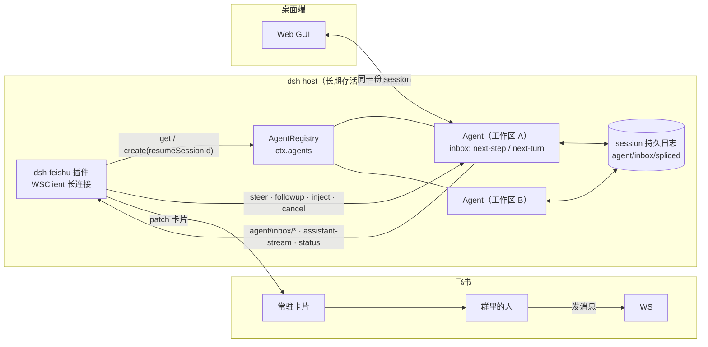

# 从底层重构：把飞书接成 DSH 的通道，而不是给 bot 加队列

> 2026-11-03 · 基于 DSH 0.2.0-rc.2 本机安装实测（`C:\Users\苏元洛\.dsh\profiles\node_modules\@deepseek-ai\`）
> 结论全部有源码位置，不是推测。

---

## 0. 一句话结论

现在飞书里"补充一句就弹排队"，**不是队列设计得不好，是通道选错了**。

`bot.py` 用 `dsh headless` 子进程执行任务，而 headless 官方定义就是**一次一问一答、没有交互式后续**：

> `dsh-headless/README.zh.md:12` — "主要边界：每次调用只运行一个任务，没有交互式后续。"
> `dsh-headless/README.zh.md:54` — "本进程中已存在持有该 id 的存活 Agent 时会被拒绝：它的原 owner 可能仍在驱动它，runner 无法取得独占的运行区间。"

子进程里没有"正在跑的 agent"这个概念，所以 bot 只能自己在外面拼一个队列（`bot.py:1047 pending_task`），补充的话无处可去，只能变成"下一个任务"（`bot.py:1062` 一句静态文本）。

**而 DSH 的 agent 本来就有持久收件箱**。桌面端你之所以能边跑边插话，是因为它持有 Agent 句柄，走的是 `agent.steer()` / `agent.followup()`，落到 `next-step` / `next-turn` 两条队列里 —— 模型下一个 step 就能看见。

要"从最底层改"，正确的事是：**把飞书做成 DSH 的一个通道插件（in-process），删掉子进程和自建队列**。这样飞书和桌面端共用同一个 host、同一个 agent、同一份 inbox、同一份历史、同一张卡片。

---

## 1. 证据链：底层到底提供了什么

### 1.1 Agent 句柄的三个注入口（这是整个方案的地基）

`dsh-agent/README.zh.md:47` 原文：

> 句柄的方法把带标识的 user 角色消息路由进 agent 的收件箱。`followup()` 排队一条普通的下一个轮次提示词并唤醒驱动器；`steer()` 提交下一步输入并唤醒它；`inject()` 添加面向模型的上下文但不唤醒驱动器，因此它落在下一个被接纳的步骤中。

签名在 `dsh-agent/lib/types/runtime-types.d.ts`：

| 行 | 成员 | 语义 |
|---|---|---|
| `:139` | `interface Agent` | agent 句柄 |
| `:145` | `readonly inbox: Inbox` | 持久收件箱 |
| `:192` | `followup(message: UserMessage): void` | 排到 **next-turn**，唤醒驱动器 |
| `:200` | `steer(message: UserMessage): void` | 排到 **next-step**，最近的一个步骤边界就消费 |
| `:209` | `inject(message: UserMessage): void` | 只加上下文，不唤醒 |
| `:157` | `cancel(cause, options?: CancelOptions): void` | 中止；`keepInbox` 可保留排队项（`:34`） |
| `:164` | `whenIdle(): Promise<void>` | 整机停稳 |
| `:263` | `agent/inbox/inserted` | 一条消息进队列（实时事件） |
| `:277` | `agent/inbox/claimed` | 一条被某个 step 领走 |
| `:289` | `agent/inbox/discarded` | 一条被取消 |

### 1.2 收件箱是持久的，不是内存队列

`dsh-agent-loop/README.zh.md:71`：

> 每次 inbox 变更都会提交一条规范化的 `agent/inbox/spliced` 事件。投影注册表会同步折叠该事件，因此 `Session.append()` 返回时，实时投影已经反映该 splice。

`dsh-agent-loop/lib/types/inbox.d.ts:38` 的 `ReactLoopInbox` 暴露 `append / prepend / replace / remove / splice / claim / clear / hasPending`，两条队列就是投影 key `'inbox'` 的两个字段（`:12`）：

```ts
{ 'next-turn': UserMessage[]; 'next-step': UserMessage[] }
```

→ **进程崩了、机器重启了，未领取的输入还在持久事件流里**，重建时按 `splice` 坐标回放。这解决了"排队丢了""跑一半重启全忘"。

### 1.3 领取语义（决定了"补充"什么时候生效）

`dsh-agent-loop/README.zh.md:119`：

> 在轮次边界，它先打开持久轮次，再**原子领取待处理的 next-step 输入与一条排队提示词**；在步骤之间则只领取 next-step 输入。

`dsh-agent-loop/README.zh.md:85`：

> 领取会从 inbox 移除候选消息，领取后插入的消息则等待后续边界。

→ 所以：
- 想"马上影响当前这一轮"→ `steer()`（下一个 tool 边界就吃到）
- 想"这一轮跑完接着做"→ `followup()`（下一个 turn）
- 想"只给点背景，别打断"→ `inject()`
- 想"撤回我刚说的话"→ `inbox.remove(messageId)`（`inbox.d.ts:76`）

### 1.4 注册表：怎么拿到 leave 在跑的那个 agent

`dsh-agent/lib/types/index.d.ts` 的 `AgentRegistry`（`:198`）：

| 行 | 方法 | 用途 |
|---|---|---|
| `:278` | `create(options: CreateAgentOptions): Promise<AgentHandle>` | 新建或**按 `resumeSessionId` 恢复**（`:111`） |
| `:343` | `get(id: SessionId): Agent \| undefined` | 拿存活 agent |
| `:357` | `list(): Agent[]` | 列全部 |
| `:241` | `withInitiator(agent, operation)` | 以某个 agent 的身份执行 |

→ 飞书来一条消息：`ctx.agents.get(sessionId)` 命中就直接 `steer/followup`；没有就 `create({ resumeSessionId })` 复活它。

### 1.5 官方已经这么干了

`dsh-webhook/README.zh.md:41`：

> 成功的 `Agent.followup()` 是 webhook 操作的提交点。

即：DSH 自己给的"外部事件变成 agent 输入"范式，就是 `followup()`。飞书通道插件就是同一套路，只是把 webhook 换成飞书长连接。

---

## 2. 为什么不用另外两条"看起来更官方"的路

| 通道 | 是什么 | 为什么不行 |
|---|---|---|
| `dsh headless` 子进程（现状） | 一次一答 | 官方明确"没有交互式后续"；同 id 有存活 agent 直接拒绝 |
| **ACP**（`dsh --profile acp`） | stdio JSON-RPC，跨进程 | `README.zh.md:71` "每个会话一次一个提示词"（settle 到轮次结束才算完）；`:76` **"刻意不提供 DSH 专用呈现数据"**——计划、todo、终端视图全没有，卡片做不出来；`:72` 有 cancel 但整体是为「进程外 subagent / 测试运行器」设计的 |
| **SDK JSON-RPC**（`dsh --profile sdk`） | stdio JSON-RPC，极简 | `session/prompt` 是"持久入队回执"（这点很好，`:41`），但 `dsh-sdk-protocol/README.zh.md:114` **"无取消与会话关闭方法——客户端放弃轮次的方式是关闭运行时进程"**。飞书里点"停"就得杀进程，不可接受 |
| **通道插件（本方案）** | in-process cordis 插件 | 全能力：steer/followup/inject/cancel/事件流/卡片，和桌面端完全同权 |

---

## 3. 目标架构



关键点：**飞书不再是"外面驱动 dsh 的调度器"，而是 DSH 的一个入口**。队列、并发、持久化、恢复全部由 host 负责，插件只做协议转换（飞书消息 ↔ UserMessage）和呈现（事件 → 卡片）。

---

## 4. 三个必须改的设计决策

### 4.1 会话归属：从「人 + 目录」改到「工作区」

现状 `bot.py:1039` 用 `sess_key(open_id, cwd)`，一人一队列，同一目录两个人同时干就是两个子进程改同一个目录 —— 这正是你之前感觉"它俩打架"的根源。

改成：**一个工作区目录 = 一个 session = 一个 agent**。人只作为消息的 author 元数据。收益是连锁的：

- 天然串行（一个 agent 一次只有一个 turn）
- 天然共享可见（同一目录下所有人看到同一张卡片、同一份历史）
- 天然无写冲突（不需要再发明目录锁）
- 和业界一致：Cursor 按 workspace、Devin 按 session、Claude Code 按 project 组织上下文

同一目录的第二个人发指令，语义自然变成 `steer`（插进当前这轮）或 `followup`（排下一轮）——**这正是你想要的"补充"体验**。

#### 会话键长什么样

现状 `sess_key = "%s|%s" % (open_id, cwd)`（`bot.py` 里）—— 人变了就换记忆。改成三级回落，抄的是 OpenClaw 的 `groupSessionScope` 和 Claude Tag 的 thread 模型：

```
优先：   lark:{tenant}:{chat_id}:thread:{omt_xxxxxxxx}    ← 话题内（飞书 topic id 前缀 omt_）
回落：   lark:{tenant}:{chat_id}:msg:{om_xxxxxxxx}        ← 群内回复某一串消息，用 reply root 的 om_ 当键
默认：   lark:{tenant}:{chat_id}                          ← 整个群一条线（你现在这种用法）
```

关键点：

- **飞书话题 ID 前缀是 `omt_`，消息 ID 前缀是 `om_`**（官方 message / thread-introduction 文档）。话题内消息事件带 `thread_id`；**发起话题的那条消息事件可能不带**，要回查一次飞书，否则首轮和后续会掉进两个 session。
- 若用户把群里普通回复转成话题，事件里的 `thread_id` 是后补的 —— 这时用 **reply root 的 `om_*`** 当键，保证同一条线首尾同 session（OpenClaw 踩过这个坑，写进它的 feishu `advanced-configuration`）。
- Claude Tag 的规则值得直接借：**「一旦 thread 里有活跃 session，它属于该 thread 里所有人」** —— 任何人在话题里回复（不用再 @）就是给这个 session 注话。`/restart` 归档重开，删首条消息 = 关闭（归档不删）。

一句话：**会话的单位是「这条对话线」，不是「这个人」。**

### 4.2 三档语义，而不是"排不排队"

| 用户动作 | 通道 | 效果 |
|---|---|---|
| 空闲时发指令 | `followup()` | 开新 turn |
| **跑着的时候补一句** | `steer()` | 当前轮的下一个 step 边界吸收，模型立刻看到 |
| 给背景/约束，别打断 | `inject()` | 只进上下文，不唤醒 |
| 点「停」 | `cancel({kind:'user'}, {keepInbox:true})` | 中止当前轮但**保留**已排队的话 |
| 撤回刚发的 | `inbox.remove(messageId)` | 从队列里摘掉 |

> 注：`cancel()` 默认会清空收件箱，`README.zh.md:178` 明说。所以"停"按钮必须显式带 `keepInbox: true`，否则用户排的话全没了。

### 4.3 可见性 = 事件投影，不是补一句文案

现状 `bot.py:1062` 发一行 `"⏳ 前面还有 %d 个在跑"` 就再也不管了。改成一张常驻卡片，由 `agent/*` 事件驱动 patch：

| 事件 | 卡片变化 |
|---|---|
| `agent/status` | 顶部状态：思考中 / 执行工具 / 等待审批 / 空闲 |
| `agent/assistant-stream` | 正文流式追加（现在 bot 是 2s 节流全量重画，`bot.py:810`，会丢帧） |
| `agent/inbox/inserted` | 排队区+1，显示"谁排的、排第几" |
| `agent/inbox/claimed` | 该条从排队区移到"正在处理"，标注它属于第几轮 |
| `agent/inbox/discarded` | 显示"已撤回/已取消" |
| `turn/*` | 轮次结束，排队区第一条自动上升 |

排队位置不用估：`inbox.nextTurn.length` 就是准确值。

### 4.4 注入只能发生在"工具调用配对边界"（这是全行业踩过的坑）

这条不是我猜的，是六个独立实现共同收敛出来的硬约束：

| 出处 | 原话 / 事实 |
|---|---|
| **OpenHands issue #1841** | 工具执行中途注入消息 → message history 被破坏 → Claude API 直接 `invalid_request_error`。反例标杆。 |
| **Cursor Cloud Agent API** | "a steer … reaches that run at its **next safe step** unless the run ends first"。 |
| **GitHub Copilot SDK** | "If the agent has already **committed to a tool call**, the steering takes effect **after that call completes**"。 |
| **OpenClaw**（开源 IM agent 网关，自带飞书渠道） | 一条 assistant 消息里的多个 tool calls 是 **committed plan**，steering **不打断已在跑的工具调用**；顺序模式里每个后续调用前检查 steering，有 steer 在等就跳过未启动的 tail，并补成对的 tool start/end + 合成结果 `"Skipped to process an incoming message."` |
| **Anthropic Claude Agent SDK** | 只有 streaming input mode 支持排队；single mode 明确"不支持 queueing / interruption"。 |
| **OpenAI Responses steering** | 仅 GPT-6 + WebSocket；排队中的 steer "**只在当前连接、不随 response 持久化**，断线不保证生效"。 |

结论：**不要在任意时刻把文本塞进对话**，只能在"上一次工具结果已落、下一次模型调用未发"的缝里塞。

而 DSH 的 inbox 命名恰好就是为这件事起的：

- `nextStep`（next-step）→ 在**下一个 step 边界**领取 → 这正是 steer 的"next safe step"语义
- `nextTurn`（next-turn）→ 在**下一个轮次边界**领取 → 这正是 followup

`dsh-agent-loop/README.zh.md:119`：「轮次边界先打开持久轮次，再原子领取待处理的 next-step 输入与一条排队提示词；步骤之间只领取 next-step 输入。」——**这跟 OpenClaw 描述的"committed plan + 每个后续 tool call 前检查"是同一个东西**，DSH 已经实现好了，我们只是把飞书消息接到这两个队列上。

所以「补充指令」不是抢跑，而是走到该走的那条缝里。用户在飞书上看到的"已接收 → 已注入（第 N 步）→ 模型回应"三段，就是这个语义的投影。

### 4.5 steer 还是 followup：默认 followup，显式才是 steer

同一个坑的第二课：**别把"用户随手又发一句"默认当成 steer**。

- GitHub Copilot SDK：`MessageOptions.mode` 默认 `"enqueue"`；steer 进 `ImmediatePromptProcessor`，**到 turn 结束还没被消费就自动 fallback 回队首**。
- OpenClaw `/queue` 四模式：`steer` / `followup` / `collect`（静默窗口后合并成一条）/ `interrupt`（中止重跑最新）；`allowCollaborativeSteering` 默认 true。
- Cursor：无活跃 run → `{"delivery":"queued"}`；有活跃 run 且显式 `delivery:"steer"` → `202 {"delivery":"steered"}`；单 agent 只允许**一个**活跃 run，否则 `409 agent_busy`。

本方案对应：

| 飞书上的输入 | 落到哪个队列 | 理由 |
|---|---|---|
| 空闲时发消息 | `followup` → `nextTurn` | 开新轮 |
| 跑着时发消息，**默认** | `followup` → `nextTurn` | 跟业界默认一致；不会被误判成打断 |
| 跑着时发消息，**带 `@机器人 /steer` 前缀或卡片上的"插话"按钮** | `steer` → `nextStep` | 显式要求抢在当前轮 |
| 动态追加的约束（"别改那个文件"） | `inject` | 只进上下文，不唤醒 |
| 卡片「停」 | `cancel({kind:'user'},{keepInbox:true})` | 独立路径，不前插 |

如果 steer 一直没被消费（当前轮已到尾声），插件在 `turn/finished` 时把它**挪回 `nextTurn` 队首**（Copilot SDK 的 fallback 行为），不会丢。

---

## 5. 落地代码

### 5.1 包结构

```
dsh-feishu-channel/
├─ package.json
├─ cordis.patch.yml
└─ lib/
   ├─ index.js        # 插件入口：name / inject / apply
   ├─ feishu-ws.js    # 飞书长连接 + 消息准入
   ├─ router.js       # 消息 → (workspace, session, handle) 路由
   ├─ card.js         # 事件 → 卡片 patch
   └─ binding.js      # 消息映射：feishu message_id ↔ UserMessage.id（幂等）
```

### 5.2 插件入口的最小正确形态

参照本机已有的第三方插件 `C:\Users\苏元洛\.dsh\plugins\dsh-purge\lib\index.js:39-43`：

```js
export const name = "dsh-feishu";
export const inject = ["agents"];        // 只 inject 确定存在的服务
export function apply(ctx, config) { /* ... */ }
```

`cordis.patch.yml` 里挂上（同 `dsh-purge/cordis.patch.yml:36` 的 insert 写法）：

```yaml
- insert:
    - id: dsh-feishu
      name: 'dsh-feishu'
      inject: [agents]
      config:
        appId: !!js process.env.FEISHU_APP_ID
        appSecret: !!js process.env.FEISHU_APP_SECRET
        workspaceRoot: /home/agent/work
        requireMention: true
```

### 5.3 核心逻辑（伪码即实现骨架）

```js
// 一条飞书消息进来
async function onMessage(msg) {
  const ws = resolveWorkspace(msg)              // /cd 状态或默认根目录
  const sessionId = sessionFor(ws)               // 工作区 → 稳定 sessionId
  let agent = ctx.agents.get(sessionId)
  if (!agent) agent = await ctx.agents.create({ resumeSessionId: sessionId })  // 恢复持久会话

  const userMessage = toUserMessage(msg)         // { id, role:'user', content:[...], source:{kind:'feishu',...} }
  if (!agent.status.running)      agent.followup(userMessage)
  else if (msg.intent === 'context') agent.inject(userMessage)
  else                            agent.steer(userMessage)   // ← 这里就是"补充指令"
}
```

`UserMessage` 的形状见 `dsh-llm/lib/types/message.d.ts:144`：

```ts
{ id: MessageId, role: 'user', content: ContentBlock[], source: MessageSource }
```

`source` 是可扩展的（`dsh-webhook` 就是自定义了 `source.kind: "webhook"`），飞书通道用 `{ kind: 'feishu', chatId, openId, msgId }`。

### 5.4 幂等（这是"可靠"的关键一环）

飞书长连接会重投事件。用 `binding.js` 维护 `feishu_msg_id → MessageId` 映射表（SQLite 或 jsonl），重复投递时：

- 已存在 → `inbox.replace(messageId, 新内容)`（用户编辑）或直接丢（纯重投）
- 不存在 → 新 append

`dsh-webhook/README.zh.md:72` 明确说"无内置去重——提供方重复交付可能创建重复会话；需要幂等性的规则自行负责"。这块必须自己兜。

**顺序铁律：先落一行 outbox，再调 agent。**
LangGraph 官方文档点破了这个坑：首个 checkpoint 落盘前崩溃的线程，与"从未收到请求"**无法区分**（`get_tuple → None`，`invoke(None)` 抛 `EmptyInputError`）。所以 IM 接单必须先把"我收到了这条飞书消息"落成自己的持久行（状态 `accepted`），再往 agent 里注入。崩溃后按 outbox 补投，靠 `(chat_id, msg_id)` 唯一键去重。

### 5.5 任务所有权：租约 + 心跳

插件进程如果挂了，正在跑的 agent 跑哪去了？这块直接抄 Procrastinate 的成熟数值（PostgreSQL 队列，官方实测）：

- worker 每 **10s** 更新 heartbeat
- heartbeat 超 **30s** 未更新 → 判定 stalled，任务收回重排
- 正常关闭时删 heartbeat

对应到我们：插件每 10s 给自己写心跳；重启后发现上一次心跳是陈旧的，就走 `create({ resumeSessionId })` 把会话接回来 —— 因为会话本身是持久的，丢的只是"这一次进程内的等待"。

### 5.6 工作区隔离的分级选择

调研结论（git worktree / Perforce / 容器三家的真实做法）：

| 方案 | 谁在用 | 代价 | 适合本项目的场景 |
|---|---|---|---|
| 一个工作区一个 agent（本方案） | LangGraph `thread_id` 单写者串行化 | 同目录全局串行 | **默认**：一个人/一个小团队改一个项目 |
| 每任务一个 git worktree | OpenHands Agent Canvas（Local/Worktree/Docker 三 runtime）、Vibe Kanban（含孤儿 worktree 回收器） | 需要合并动作 | 需要**并行**跑多个互不干扰的改代码任务 |
| 容器级沙箱 | OpenHands（每会话一容器，`--cap-drop ALL`、idle TTL 1200s 后停容器但不丢会话）、Modal（默认 5min / 最长 24h）、E2B（`pause()` 连内存一起存，无 TTL 需自建 GC） | 重、要镜像 | 跑不可信代码 / 需要隔离依赖 |

**重要反例**：Cursor Cloud Agent **不是** worktree，是"每任务一台云端 VM + 独立分支 + push + 开 PR"，多人协作靠**只读共享 + PR 交接**，而不是多人并发改同一份工作区。
→ 结论：业界主流是「**共享读取 + 单一写者**」。本方案"一个工作区一个 agent"正好是这个模型的直接实现，不需要再发明目录锁。

git worktree 如果想后期加上，官方自带的两个钩子正好是我们要的语义：

```bash
git worktree add --lock --reason "task-123" ../wt-task-123 feat/x   # 原子加锁，避免 race
git worktree prune --expire 3.days.before                            # 回收孤儿
```

（`--lock` 在 `add` 时原子创建，文档专门说明是为了避免 race；`worktree add` 对已被别处 checkout 的分支默认拒绝，等于免费互斥。但官方 BUGS 节也警告 multiple checkout 仍是 experimental、submodule 支持不完整。）

### 5.7 卡片更新的硬约束（飞书和 Slack 都有）

- Slack `chat.update`：只给 `text` 不给 `blocks` 会**清空** blocks；blocks 更新**不显示 edited 标记**；只能改自己发的消息；限流 Tier 3（50+/min）；流式输出期间 update 会报 `streaming_state_conflict`。
- 飞书：卡片走 `PATCH /open-apis/im/v1/message-card/*`，reaction 走 `POST .../message-reaction`。
- → 所以卡片必须：**一条常驻消息原地 patch + 合并节流**（500ms 窗口，硬上限 1 次/秒），不能像现在的 `bot.py:810` 那样 2s 全量重画。

---

## 6. 落地步骤（可回滚，分四步）

| 阶段 | 动作 | 回滚 |
|---|---|---|
| **0 影子** | 插件只**观察**：接入 host，把飞书消息转成 UserMessage 记到 sidecar 日志，不注入。同时 bot.py 照常跑 | 停插件 |
| **1 接管单聊** | 只对白名单里一个人 + 一个测试目录开启注入（走 `steer/followup`），卡片只发到测试群 | 配置里把人摘掉 |
| **2 接管全部** | 所有工作区走插件；bot.py 降级为"只处理 `/cost` `/ls` 这类非 agent 命令" | 恢复 bot.py 队列 |
| **3 下线** | 删除 bot.py 的 `RUNNING/QUEUES/pending_task`，PVE 上 `feishu-bot.service` 只留日报 | 保留 git 历史 |

每阶段都有独立可观测指标：注入成功率、`inbox` 平均深度、steer 命中率（有多少补充指令被同一轮吸收）、卡片 patch 延迟。

---

## 7. 边界与风险（先说清楚，别事后扯皮）

1. **插件跑在哪台机器** —— 必须在长期存活的 dsh host 上（即 agent 机器 192.168.1.205），不是 PVE 门房。PVE 上的 `feishu-bot.service` 要退成"只管日报/额度"。
2. **一个 host 多工作区** —— `ctx.agents.list()` 会同时有多个 agent，内存与 CPU 要能扛。当前 agent 机是 VM 904，`/home/agent/work` 挂 USB 盘（已加固 `werror=report`），并发多了 IO 会是瓶颈。
3. **飞书长连接只能一条** —— 同一个 app 同时只允许一个 WS 连接，否则互相踢。**本方案已经绕开这个限制**：长连接仍然只在 PVE 的 `bot.py`（它已经是成熟的、带白名单和审批的适配层），插件只暴露 HTTP `8788` + SSE `/events`，不碰 WS。所以不需要把 bot 的 WS 停掉，两个进程各管一段。
4. **`steer` 不是"立刻打断"** —— 它在**下一个 step 边界**生效。如果模型正在跑一个长 tool（比如 30 分钟的构建），steer 要等它回来。想要真打断只有 `cancel()`。这个预期要写进卡片文案，否则用户会觉得"没反应"。
5. **卡片 patch 限流** —— 飞书对同一 message 的更新有频率限制，必须做合并节流（建议 500ms 合并窗口 + 最多 1 次/秒）。现有 bot.py 是 2s 全量重画（`bot.py:810`），照搬会既慢又丢流。
6. **重启恢复** —— `create({ resumeSessionId })` 只恢复**已持久化**的会话；`resume` 会拒绝跨 cwd、子 agent、fork、preset 不匹配的会话（`dsh-headless/README.zh.md:54` 列了完整拒绝条件）。插件的 sessionId 生成规则必须稳定且与 cwd 绑定。

---

## 8. 这份方案和上一版的区别

| 上一版（三层补丁） | 这一版（底层重构） |
|---|---|
| 在 bot.py 里让排队卡片可刷新 | 删除 bot 的队列，改用 DSH 原生 inbox |
| 在 bot.py 里给"追加"加个开关 | 用 `steer/followup/inject` 三档原生语义 |
| 在 bot.py 里加目录互斥锁 | 一个工作区一个 agent，天然串行，不需要锁 |
| 关机/重启后队列丢失 | `agent/inbox/spliced` 持久回放 |
| 桌面端和飞书是两套东西 | 同一个 host、同一份 session，两边看到同一张卡 |

一句话：**上一版是在错误的通道上修队列；这一版换掉通道。**

---

## 9. 业界对照总表（每一行都对应本方案的一个具体设计）

调研覆盖 20+ 个项目/文档，只列真正影响了代码的那几条：

| 本项目里的选择 | 出处 | 原话 / 事实 |
|---|---|---|
| 注入只走 `next-step`，绝不插进中间 | Cursor Cloud Agent API | "a steer … reaches that run at its **next safe step** unless the run ends first" |
| 同上 | GitHub Copilot SDK | "If the agent has already **committed to a tool call**, the steering takes effect after that call completes" |
| 同上（反例） | OpenHands issue #1841 | 工具执行中途注入 → message history 被破坏 → Claude API `invalid_request_error` |
| 同上 | OpenClaw `queue-steering` | 一条 assistant 消息里的 tool calls 是 **committed plan**，steer 不打断在跑的工具；顺序模式下跳过未启动的 tail 并补合成结果 `"Skipped to process an incoming message."` |
| 跑着时默认 `steer`、空闲默认 `followup` | OpenClaw `/queue` | 默认 `mode="steer"`，`allowCollaborativeSteering` 默认 true，四模式 steer/followup/collect/interrupt |
| 同上（另一侧） | Copilot SDK `MessageOptions.mode` | 默认 `"enqueue"`；steer 进 `ImmediatePromptProcessor`，turn 结束没消费就**自动 fallback 回队首** |
| 一个会话同时只有一个活跃轮 | Cursor Cloud Agent API | 单 agent 只允许一个活跃 run，否则 `409 agent_busy`；无活跃 run 时 steer 返回 `{"delivery":"queued"}` |
| 会话键用 `thread_id` / reply root | 飞书开放平台 + OpenClaw | 话题 ID 前缀 `omt_`、消息 ID 前缀 `om_`；`groupSessionScope` 四档，话题 session key 用事件 `thread_id`，群回复转话题时用 reply root 当 key |
| 一个话题里所有人共用同一会话 | Claude Tag | "一旦 thread 里有活跃 session，它属于该 thread 里所有人"，任何人回复即 steer |
| 先落 outbox 再投递 | LangGraph checkpointer 官方警告 | 首个 checkpoint 落盘前崩溃的线程与「从未 invoke」无法区分（`get_tuple→None`，`invoke(None)` 抛 `EmptyInputError`）→ **收到请求先写自己的 outbox 行再 invoke** |
| 租约心跳 10s / 判死 30s | Procrastinate（PostgreSQL 队列） | worker 每 10s 更新 heartbeat，超 30s 未更新判 stalled 并 `retry_job()` |
| 一张整卡替换 + rev 回执 | OpenClaw progress-card | 每 session 一张持久卡，**每次整卡替换（非 patch）**，回执 `"(rev 4, 1/3 done)"`，`accepted ≠ 已更新` |
| 只报 N ahead 与 x/y，**不造 ETA** | OpenClaw progress-card | 原文 "never invent percentages"；`queueAhead` 文档明说「不代表最终准入顺序」 |
| 卡片合并节流 | Slack `chat.update` + 飞书 PATCH | Slack 只给 text 不给 blocks 会清空 blocks、流式中 update 报 `streaming_state_conflict`、Tier 3 = 50+/min；飞书 PATCH 发送后 14 天内可更新 |
| 停/撤回走独立路径 | OpenClaw `chat.abort` + Restate | abort 只能撤回**尚未开始投递**的排队消息；Restate「Interrupt & Regenerate」= cancel → attach 等清理（带超时）→ 起新任务 → 更新历史 |
| 用户消息要能回"已接收/已拒绝" | Temporal | 建议建成 **Update** 而非 Signal：IM 必须能回执，且需要 validator 校验权限与状态 |
| 工作区并发 = 声明的输入集合 | Bazel | 并发单元 = action 的输入集合，相交则串行 → 印证「一个工作区一个 agent」 |
| 每任务隔离用 worktree | git `worktree add --lock` | `--lock --reason "task-123"` 原子加锁避免 race；对已 checkout 分支默认拒绝＝免费互斥；`prune --expire` 回收孤儿 |
| 反例：Cursor 不是 worktree | Cursor 文档 | 每任务一台云端 VM + 独立分支 + push + PR 交接，不是本地 worktree |

明确没找到可靠来源、因此**没有作为设计依据**的：Aider / Cline / goose 的连发消息策略；Ably interruption-and-steering 正文（302 到 /streaming）；Vercel AI SDK 原生 steer（只有 tool `needsApproval` 可证）；Devin session 内部消息模型（只证到「追加即 resume」）。

---

## 10. 交付清单

| 文件 | 作用 | 状态 |
|---|---|---|
| `dsh-feishu-channel/package.json` | 插件包定义，`dsh.bundle.patch` 指向注册表 | 已落盘 |
| `dsh-feishu-channel/cordis.patch.yml` | 注册行（port 8788 / token / workspaceRoot / stateDir） | 已落盘 |
| `dsh-feishu-channel/lib/index.js` | 插件主体：HTTP + SSE + `ensureAgent` + `ingest` + `control` + `recover` | `node --check` 通过 |
| `dsh-feishu-channel/lib/sessionkey.js` | 会话键三级回落 + `sessionIdFor` 确定性派生 | 自检覆盖 |
| `dsh-feishu-channel/lib/store.js` | `Outbox`（JSONL+fsync 幂等）/ `SessionState` | 自检覆盖 |
| `dsh-feishu-channel/lib/card.js` | 视图 → 飞书卡片（整卡替换，带 key/rev，无 ETA） | 自检覆盖 |
| `dsh-feishu-channel/test/selfcheck.mjs` | 纯逻辑自检 | **34 通过 / 0 失败** |
| `dsh-feishu-channel/README.md` | 装机 5 步 + 三层回滚 + 排障表 | 已落盘 |
| `feishu-bot/channel.py` | 宿主侧客户端：`session_key` / `ingest` / `control` / `watch`(SSE) | `py_compile` 通过 |
| `feishu-bot/bot.py` | 加 `channel_mode` 开关、`send_via_channel`、`on_channel_view`、`channel_stop`、`/queue` `/清队` 走真值、卡片按钮接 `stop/recall/clearQueue` | `py_compile` 通过；老路径一行未删 |

改动全部是**加法**：`channel_mode: "off"` 时行为与改之前完全一致。
